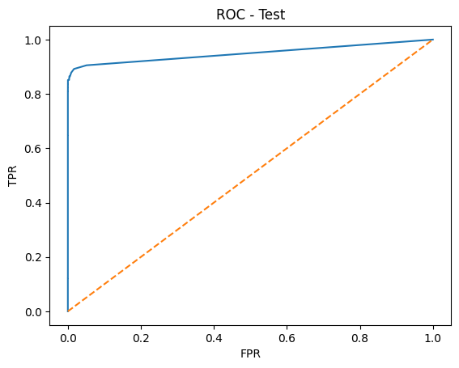
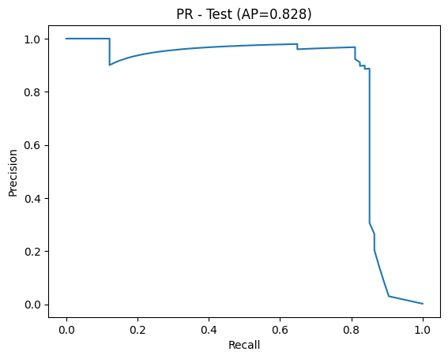
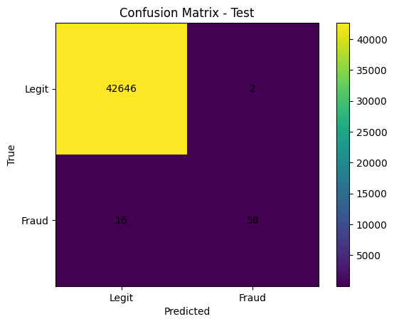

# Credit Card Fraud Detector

An end-to-end machine learning project created by **Tayaba** to identify potentially fraudulent credit card transactions. It compares Logistic Regression and Random Forest models, evaluates them on an imbalanced dataset, and saves the selected model and its decision threshold for scoring transactions.

## Project Overview

The project uses the [Kaggle Credit Card Fraud Detection dataset](https://www.kaggle.com/datasets/mlg-ulb/creditcardfraud), which contains anonymized transaction features (`V1`–`V28`), `Time`, `Amount`, and a `Class` label (`0` for legitimate and `1` for fraud). The dataset is not included in this repository and must be downloaded separately.

In `train.py`, `Time` and `Amount` are scaled with `RobustScaler`. The data is split into training, validation, and test sets with stratification to preserve the class balance. Class weights are used to account for the rarity of fraud. The script selects the model with the best validation precision-recall AUC, chooses a classification threshold by maximizing validation F1, and evaluates the result on the test set. It also includes a Gradio interface for uploading a CSV and reviewing fraud probabilities.

## Results

The saved evaluation metadata reports:

- Selected model: Random Forest
- Validation PR-AUC: **0.821**
- Test Average Precision (AP): **0.828**
- Selected decision threshold: **0.32**

These are precision-recall metrics, not accuracy scores. An accuracy value is not included in the saved results; because fraud is rare, accuracy alone would also be an incomplete measure of model performance.

## Evaluation Plots

**ROC curve (test set)**

**Precision-recall curve (test set; Average Precision 0.828)**

**Confusion matrix (test set)**

## Files

- `train.py` - training, evaluation, artifact saving, and Gradio CSV-scoring code. The script is set up for Google Colab and reads the dataset from Google Drive.
- `best_pipeline.joblib` - trained preprocessing and Random Forest pipeline.
- `threshold.json` - selected model, threshold, validation PR-AUC, and test AP.
- `top_features.csv` - saved feature importance values.
- `roc_test.png`, `pr_test.png`, `cm_test.png` - evaluation plots.

## Run in Google Colab

1. Open `train.py` in a Google Colab notebook (or adapt its notebook cells).
2. Download the Kaggle dataset and put `creditcard.csv` at `MyDrive/fraud-detector/data/creditcard.csv`, matching the path configured in the script.
3. Run the script cells. The script installs its Python dependencies, trains and evaluates the models, writes artifacts and plots to the project folders in Drive, and launches the Gradio interface.
4. Upload a CSV with the same transaction feature columns to get fraud probabilities and predictions. If the CSV includes `Class`, the interface also displays precision and recall for that file.

The script expects the dataset to contain a `Class` column during training. For scoring, that column is optional.
